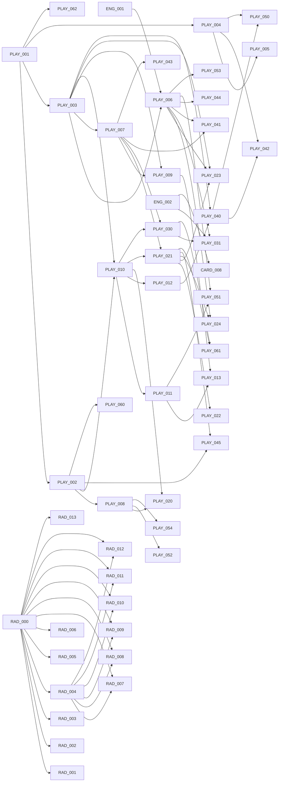

# Tickets

One file per ticket. Ticket ids: `PLAY` for the play interface (`play/`), `ENG` for engine work (`src/`), `CARD` for partial or missing cards from the existing sets, `RAD` for the Radiance set.

Priorities: **P0** now, **P1** next, **P2** after that, **P3** later. The list below is in working order: each ticket comes after everything it depends on.

Source documents: [ui-roadmap.md](../ui-roadmap.md) and [card-status](../card-status/README.md). Card tickets were generated once, on 2026-11-06, from `docs/card-status/card-status.csv` and the card text. Edit them by hand from now on; rerunning `scripts/card_status.py` does not update them.

> **Written against `b05e51d` (2026-10-10), before the rebase onto upstream `ec90f0f`.** Upstream's 947 newer commits implemented ENG-002 (group moves) and work that overlaps PLAY-002, PLAY-004 and PLAY-005 (seat-bound sessions, fair-play frames, `decision_id` checks), and fixed many cards. Check a ticket against the current code before starting it; `docs/card-status/` also needs regenerating. See section 7 of [phase1-visual-board.md](../phase1-visual-board.md).

## Working order

| # | Ticket | Priority | Area | Status | Depends on |
|---|---|---|---|---|---|
| 1 | [CARD-001](CARD-001-fix-confirmed-bugs-in-implemented-cards.md): Fix confirmed bugs in implemented cards | P0 | Cards | todo |  |
| 2 | [CARD-002](CARD-002-offer-the-choices-that-cards-currently-make-for-the-player.md): Offer the choices that cards currently make for the player | P0 | Cards | todo |  |
| 3 | [ENG-001](ENG-001-structured-prompt-kind-for-every-choice.md): Structured prompt kind for every choice | P0 | Engine | todo |  |
| 4 | [ENG-002](ENG-002-group-moves-cr-144-3.md): Group moves (CR 144.3) | P0 | Engine | done |  |
| 5 | [CARD-008](CARD-008-movement-combat-and-scoring-rules.md): Movement, combat and scoring rules | P0 | Cards | todo | ENG-002 |
| 6 | [PLAY-001](PLAY-001-split-the-play-app-out-of-the-engine.md): Split the play app out of the engine | P0 | Phase 1 | done |  |
| 7 | [PLAY-002](PLAY-002-per-seat-views-stop-leaking-hidden-information.md): Per-seat views: stop leaking hidden information | P0 | Phase 1 | done | PLAY-001 |
| 8 | [PLAY-003](PLAY-003-full-board-state-in-every-frame.md): Full board state in every frame | P0 | Phase 1 | done | PLAY-001 |
| 9 | [PLAY-004](PLAY-004-humanagent-reports-the-player-who-is-actually-deciding.md): HumanAgent reports the player who is actually deciding | P0 | Phase 0 | todo | PLAY-001 |
| 10 | [PLAY-005](PLAY-005-reject-stale-and-out-of-range-clicks.md): Reject stale and out-of-range clicks | P0 | Phase 0 | todo | PLAY-004 |
| 11 | [PLAY-010](PLAY-010-visual-board-layout-with-every-zone.md): Visual board layout with every zone | P0 | Phase 1 | done | PLAY-002, PLAY-003 |
| 12 | [PLAY-011](PLAY-011-card-rendering.md): Card rendering | P0 | Phase 1 | done | PLAY-010 |
| 13 | [PLAY-012](PLAY-012-side-panel-turn-priority-chain-actions-and-text-view.md): Side panel: turn, priority, chain, actions and text view | P0 | Phase 1 | done | PLAY-010 |
| 14 | [CARD-003](CARD-003-let-opponents-make-their-own-choices-during-a-resolution.md): Let opponents make their own choices during a resolution | P1 | Cards | todo |  |
| 15 | [CARD-004](CARD-004-non-resource-additional-costs-and-conditional-cost-changes.md): Non-resource additional costs and conditional cost changes | P1 | Cards | todo |  |
| 16 | [CARD-005](CARD-005-playing-cards-from-trash-deck-or-banishment-with-partial-cos.md): Playing cards from trash, deck or banishment with partial costs | P1 | Cards | todo |  |
| 17 | [CARD-006](CARD-006-this-turn-effects-and-turn-scoped-tracking.md): "This turn" effects and turn-scoped tracking | P1 | Cards | todo |  |
| 18 | [CARD-007](CARD-007-missing-trigger-events.md): Missing trigger events | P1 | Cards | todo |  |
| 19 | [PLAY-006](PLAY-006-send-structured-prompts-to-the-client.md): Send structured prompts to the client | P1 | Phase 0 | todo | ENG-001, PLAY-003 |
| 20 | [PLAY-007](PLAY-007-describe-what-each-legal-action-does.md): Describe what each legal action does | P1 | Phase 0 | todo | PLAY-003 |
| 21 | [PLAY-008](PLAY-008-event-stream-for-animation-and-a-readable-log.md): Event stream for animation and a readable log | P1 | Phase 0 | todo | PLAY-002 |
| 22 | [PLAY-009](PLAY-009-golden-frame-and-gesture-round-trip-tests.md): Golden-frame and gesture round-trip tests | P1 | Phase 0 | todo | PLAY-003, PLAY-007 |
| 23 | [PLAY-020](PLAY-020-animate-draws-channels-and-discards.md): Animate draws, channels and discards | P1 | Phase 2 | todo | PLAY-008, PLAY-010 |
| 24 | [PLAY-021](PLAY-021-drag-a-card-from-hand-to-play-it.md): Drag a card from hand to play it | P1 | Phase 2 | todo | PLAY-007, PLAY-010 |
| 25 | [PLAY-022](PLAY-022-chooser-when-one-drop-matches-several-actions.md): Chooser when one drop matches several actions | P1 | Phase 2 | todo | PLAY-021 |
| 26 | [PLAY-023](PLAY-023-pay-costs-by-clicking-runes.md): Pay costs by clicking runes | P1 | Phase 2 | todo | PLAY-003, PLAY-006, PLAY-021 |
| 27 | [PLAY-030](PLAY-030-drag-a-unit-to-move-it.md): Drag a unit to move it | P1 | Phase 3 | todo | PLAY-007, PLAY-010 |
| 28 | [PLAY-040](PLAY-040-chain-panel-with-target-arrows.md): Chain panel with target arrows | P1 | Phase 4 | todo | PLAY-003, PLAY-012 |
| 29 | [PLAY-041](PLAY-041-targeting-on-the-board.md): Targeting on the board | P1 | Phase 4 | todo | PLAY-006, PLAY-007 |
| 30 | [PLAY-042](PLAY-042-reactions-and-accept.md): Reactions and Accept | P1 | Phase 4 | todo | PLAY-004, PLAY-040 |
| 31 | [PLAY-050](PLAY-050-showdown-focus-and-pass.md): Showdown focus and Pass | P1 | Phase 5 | todo | PLAY-004, PLAY-040 |
| 32 | [PLAY-051](PLAY-051-combat-view-and-damage-preview.md): Combat view and damage preview | P1 | Phase 5 | todo | PLAY-006, PLAY-011 |
| 33 | [PLAY-053](PLAY-053-setup-and-mulligan-screens.md): Setup and mulligan screens | P1 | Phase 5 | todo | PLAY-006 |
| 34 | [RAD-000](RAD-000-refresh-radiance-card-data-and-scaffold-the-classes.md): Refresh Radiance card data and scaffold the classes | P1 | Cards | todo |  |
| 35 | [CARD-009](CARD-009-hidden-cards.md): Hidden cards | P2 | Cards | todo |  |
| 36 | [CARD-010](CARD-010-replacement-effects.md): Replacement effects | P2 | Cards | todo |  |
| 37 | [CARD-011](CARD-011-equipment.md): Equipment | P2 | Cards | todo |  |
| 38 | [CARD-012](CARD-012-keywords-and-targeting-rules.md): Keywords and targeting rules | P2 | Cards | todo |  |
| 39 | [PLAY-013](PLAY-013-board-parity-test-against-the-text-view.md): Board parity test against the text view | P2 | Phase 1 | todo | PLAY-011, PLAY-009 |
| 40 | [PLAY-024](PLAY-024-optional-costs-accelerate-additional-costs-repeat.md): Optional costs: Accelerate, additional costs, Repeat | P2 | Phase 2 | todo | PLAY-006, PLAY-021 |
| 41 | [PLAY-031](PLAY-031-move-several-units-together.md): Move several units together | P2 | Phase 3 | todo | PLAY-030, PLAY-006, ENG-002 |
| 42 | [PLAY-043](PLAY-043-activated-abilities-menu.md): Activated abilities menu | P2 | Phase 4 | todo | PLAY-007 |
| 43 | [PLAY-044](PLAY-044-triggers-modes-x-values-and-card-name-pickers.md): Triggers, modes, X values and card-name pickers | P2 | Phase 4 | todo | PLAY-006 |
| 44 | [PLAY-045](PLAY-045-face-down-cards.md): Face-down cards | P2 | Phase 4 | todo | PLAY-002, PLAY-021 |
| 45 | [PLAY-052](PLAY-052-score-control-and-conquer-animations.md): Score, control and conquer animations | P2 | Phase 5 | todo | PLAY-008 |
| 46 | [PLAY-054](PLAY-054-game-over-screen-and-log-export.md): Game over screen and log export | P2 | Phase 5 | todo | PLAY-008 |
| 47 | [PLAY-061](PLAY-061-click-to-select-fallback-and-keyboard-shortcuts.md): Click-to-select fallback and keyboard shortcuts | P2 | Cross-cutting | todo | PLAY-021, PLAY-030 |
| 48 | [RAD-001](RAD-001-radiance-deploy-gear-and-bomb-tokens.md): Radiance: Deploy gear and Bomb tokens | P2 | Cards | todo | RAD-000 |
| 49 | [RAD-002](RAD-002-radiance-disarm.md): Radiance: Disarm | P2 | Cards | todo | RAD-000 |
| 50 | [RAD-003](RAD-003-radiance-show-off.md): Radiance: Show Off | P2 | Cards | todo | RAD-000 |
| 51 | [RAD-004](RAD-004-radiance-recruit-and-mech-tokens.md): Radiance: Recruit and Mech tokens | P2 | Cards | todo | RAD-000 |
| 52 | [RAD-005](RAD-005-radiance-legends.md): Radiance: legends | P2 | Cards | todo | RAD-000 |
| 53 | [RAD-006](RAD-006-radiance-battlefields.md): Radiance: battlefields | P2 | Cards | todo | RAD-000 |
| 54 | [PLAY-060](PLAY-060-hot-seat-privacy-screen.md): Hot-seat privacy screen | P3 | Cross-cutting | todo | PLAY-002 |
| 55 | [PLAY-062](PLAY-062-ship-the-web-files-inside-the-binary.md): Ship the web files inside the binary | P3 | Cross-cutting | todo | PLAY-001 |
| 56 | [RAD-007](RAD-007-radiance-fury-cards.md): Radiance: Fury cards | P3 | Cards | todo | RAD-000, RAD-004 |
| 57 | [RAD-008](RAD-008-radiance-calm-cards.md): Radiance: Calm cards | P3 | Cards | todo | RAD-000, RAD-004 |
| 58 | [RAD-009](RAD-009-radiance-mind-cards.md): Radiance: Mind cards | P3 | Cards | todo | RAD-000, RAD-004 |
| 59 | [RAD-010](RAD-010-radiance-body-cards.md): Radiance: Body cards | P3 | Cards | todo | RAD-000, RAD-004 |
| 60 | [RAD-011](RAD-011-radiance-chaos-cards.md): Radiance: Chaos cards | P3 | Cards | todo | RAD-000, RAD-004 |
| 61 | [RAD-012](RAD-012-radiance-order-cards.md): Radiance: Order cards | P3 | Cards | todo | RAD-000, RAD-004 |
| 62 | [RAD-013](RAD-013-radiance-cards-with-no-domain-in-the-pre-release-data.md): Radiance: cards with no domain in the pre-release data | P3 | Cards | todo | RAD-000 |

## Dependencies

